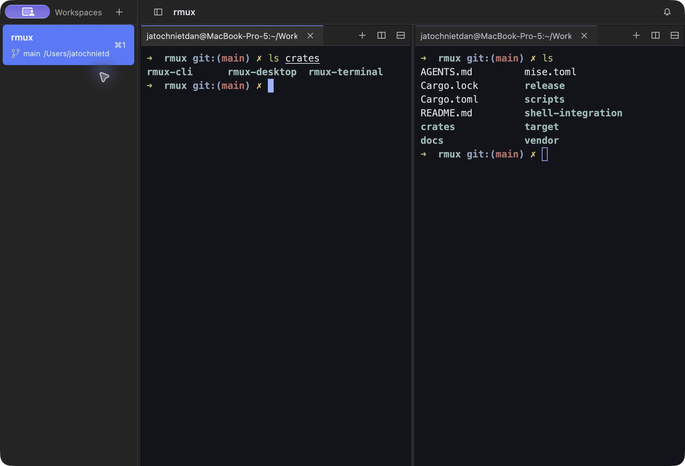

# rmux

**A native terminal workspace for keeping your projects, shells, and coding agents together.**

rmux combines a fast terminal powered by Ghostty with a sidebar for your projects,
split panes, and keyboard-first navigation. Built in Rust with a GPU-rendered
interface, it aims to stay responsive as your workspace grows.

[Download for macOS](https://github.com/JaTochNietDan/rmux/releases) ·
[Getting started](docs/trying-rmux.md) · [User guide](docs/user-guide.md)

## A home for your terminal work

- **Organize by project.** Keep named workspaces in the sidebar, with groups,
  pinned entries, colors, descriptions, working directories, and Git branches.
- **See more at once.** Arrange terminal tabs in nested horizontal and vertical
  splits. Resize panes, zoom into one, or move work between windows.
- **Stay on the keyboard.** Jump between workspaces and tabs, search with the
  command palette, and configure shortcuts for common actions and commands.
- **Keep track of background work.** In-app notifications and unread indicators
  help you find terminals that need attention.
- **Make it yours.** Adjust text size, padding, terminal colors, cursor behavior,
  and copy-on-select from Settings or the configuration file.
- **Automate your workspace.** The optional local socket and bundled `rmuxctl`
  let scripts create workspaces, send input, read terminal output, and notify you.

## Install

The first release is for **Apple Silicon Macs**. Download the ZIP from
[Releases](https://github.com/JaTochNietDan/rmux/releases), unzip it, and move
**rmux.app** into **Applications**.

The macOS release is Developer ID signed and notarized. Choose **rmux → Check
for Updates…** to check for newer versions using Sparkle.

## Start here

Open a workspace for each project, split terminals for related tasks, and use the
command palette to find actions without memorizing every shortcut. **⌘,** opens
Settings. See [Getting started](docs/trying-rmux.md) for navigation, session
recovery, and configuration.

## Early, and moving quickly

rmux is an early preview inspired by [cmux](https://cmux.com/). It is usable, but
full feature and interaction parity is still in progress. Embedded browser
surfaces, remote workflows, and native OS notifications are not yet included.
Linux and Windows are development targets; this release ships macOS only.
Performance is a design priority, not a promise of zero lag or a fixed memory
footprint on every workload.

## Building and contributing

Development tools are managed with **mise**. See [Building](docs/building.md),
[Progress](docs/progress.md), and [Performance measurements](docs/performance.md).
Please report bugs and feature requests in
[Issues](https://github.com/JaTochNietDan/rmux/issues).

Powered by [Ghostty](https://ghostty.org/), [GPUI](https://www.gpui.rs/), and
[Sparkle](https://sparkle-project.org/). Third-party notices are included in the
macOS app bundle.
